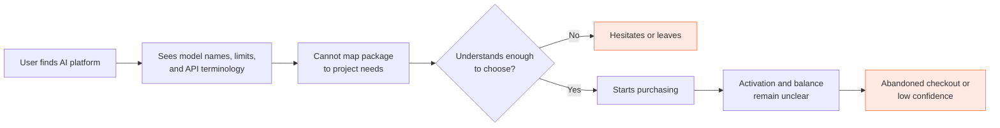
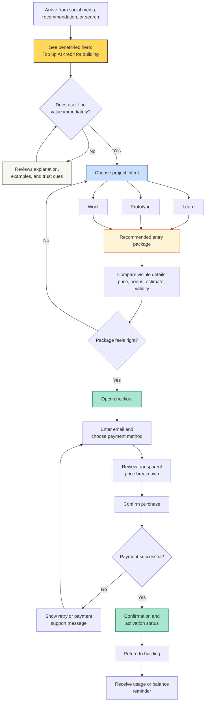
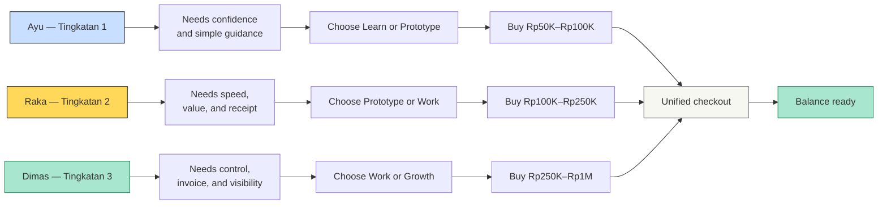

# User Journey Diagram

## Diagram 1 — Current Problem Journey

## Diagram 2 — Ideal Journey

## Persona-Specific Journey Path

# Current and Ideal User Journeys

## Current Problem Journey

1. User sees a technical AI platform.
2. User encounters model names, limits, or API terms.
3. User does not know which package maps to their project.
4. User hesitates or leaves.
5. If purchasing, activation and usage remain unclear.

## Ideal Journey — New Vibe-Coder

### 1. Awareness
User arrives from social media or a recommendation.

**Goal:** Understand what TokenNyala does in five seconds.

**Key message:** Top up AI credit for the apps and prototypes you are building.

### 2. Reassurance
User sees familiar project types and transparent examples.

**Questions answered:**
- Is this for me?
- How much should I buy?
- What payment methods are available?

### 3. Discovery
User chooses an intent: belajar, prototype, or project kerja.

**System response:** Recommended package and practical estimate.

### 4. Selection
User views nominal options and compares value.

**Visible information:** Price, bonus credit, estimated use range, validity.

### 5. Purchase
User enters name/email, chooses a mock payment method, and confirms.

**Trust cues:** Price breakdown, no hidden fees, secure-payment label, support link.

### 6. Confirmation
Success state explains activation and next steps.

**Key message:** Balance ready. One link to continue building.

## Drop-Off Risks

- Too many package options.
- Technical jargon before the package recommendation.
- Hidden delivery or payment fees.
- No clear estimate of usefulness.
- Lengthy account creation before top-up.
